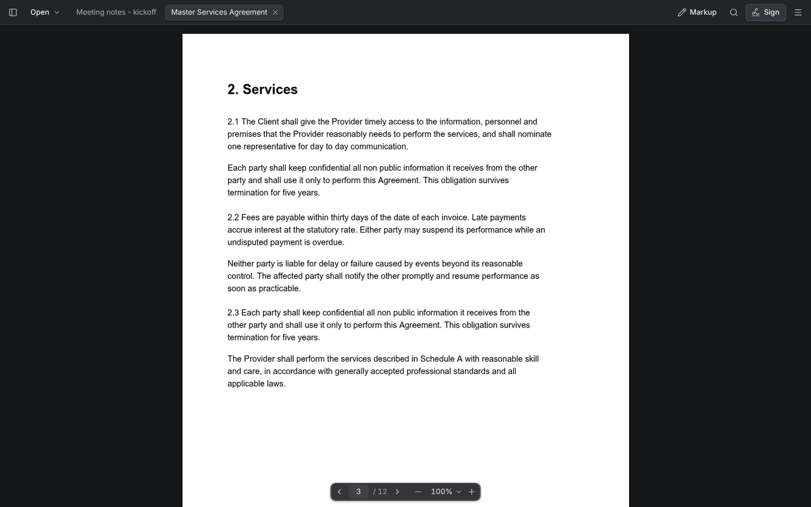
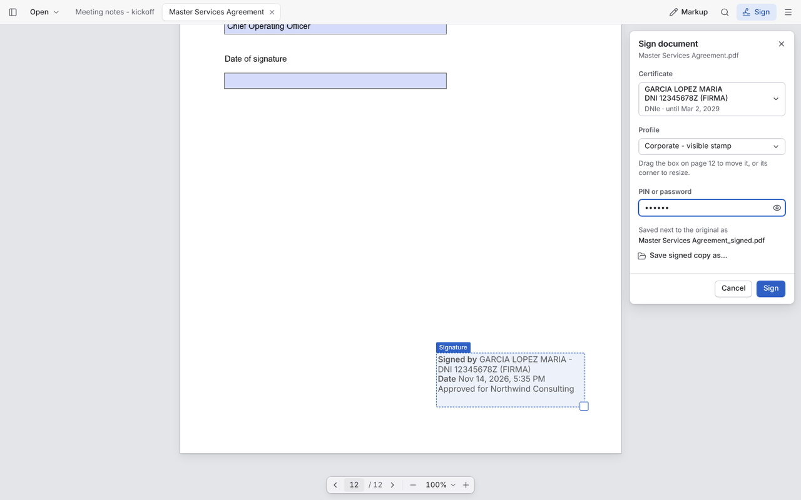

<p align="center">
  
</p>

<h1 align="center">Lankir</h1>

<p align="center">A PDF viewer and signer for Linux, with smart card and DNIe support.</p>

<p align="center">
  <a href="https://github.com/Matbe34/lankir/actions/workflows/test.yml"></a>
  <a href="https://github.com/Matbe34/lankir/releases"></a>
  <a href="LICENSE"></a>
</p>



## Features

- **Read**: tabs, page thumbnails, outline, find with match case and whole
  words, text selection, zoom presets, light and dark themes.
- **Fill in and mark up**: fill in PDF forms; highlight, add text, draw and
  place images; undo and redo; save or save as.
- **Organize pages**: rotate, reorder by dragging, duplicate, delete and
  extract pages, and insert pages from other PDFs, with undo and redo until
  you save.
- **Document tools**: split into files, set, change or remove the password,
  edit the title, author, subject and keywords, save an optimized copy, and
  print.
- **Sign**: visible or invisible signatures with certificates from `.p12` and
  `.pfx` files, smart cards and USB tokens (PKCS#11, including the Spanish
  DNIe) and the NSS database. Reusable signature profiles, and optional
  RFC 3161 timestamps.
- **Check signatures**: whether the document changed, whether the signer's
  certificate is trusted, and whether it was revoked, asking the certificate
  authority online (can be turned off).
- **Command line**: the same binary has `lankir pdf`, `lankir cert`,
  `lankir sign` and `lankir config` commands: page operations (rotate, delete,
  reorder, extract, split, merge), encryption, metadata, rendering, signing and
  verifying.
- Keyboard shortcuts, and a command palette (Ctrl K) that lists every command.

## Install

Download the AppImage, the `.deb` or `.rpm` package, or the standalone binary
from the [releases page](https://github.com/Matbe34/lankir/releases). For
example, on Debian or Ubuntu:

```bash
sudo apt install ./lankir_*_amd64.deb
```

See [Install](docs/install.md) for every option, the runtime libraries, and how
to make Lankir your default PDF app.

## Use

Open Lankir from the applications menu, or from a terminal:

```bash
lankir contract.pdf
```

Open more files with **Open**, from the recent list, or by dropping them on the
window. The [user guide](docs/user-guide.md) covers reading, forms, markup,
organizing pages, the document tools, saving, settings and every keyboard
shortcut.

## Signing

Press **Sign** (Alt S), pick a certificate and a profile, type the PIN, and
for a visible signature drag the box where it belongs. Lankir saves a signed
copy next to the original and opens it. Open the side panel's **Info** view to
check the signatures of any PDF. [Signing](docs/signing.md) explains
certificates, smart cards and the DNIe, profiles, what each signature status
means, and what Lankir sends over the network.



## Command line

```bash
lankir sign verify contract_signed.pdf --json
```

[Command line](docs/cli.md) documents every command and flag.

## Development

Go, Wails v3 (GTK 3 and WebKitGTK 4.1), pdf.js and Vite. To build and test:

```bash
task dev     # run against the Vite dev server
task test    # Go and frontend tests
```

[Development](docs/development.md) has the prerequisites, the architecture, the
preview harness and the release process. Changes are listed in the
[changelog](CHANGELOG.md).

## Support

If Lankir is useful to you, you can support its development:

<a href="https://www.buymeacoffee.com/Matbe34"></a>

- Bitcoin (BTC): `bc1q7utue52q2m66spl3prz3xxmmdw9varcupfa20f`
- Monero (XMR): `681AX96pcCFNbFs82MeQVR6W3pDCHRTHEGGHBMZiafLL`

## License

MIT. See [LICENSE](LICENSE).
