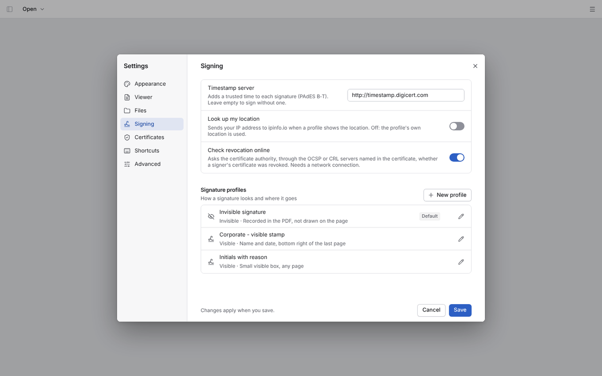
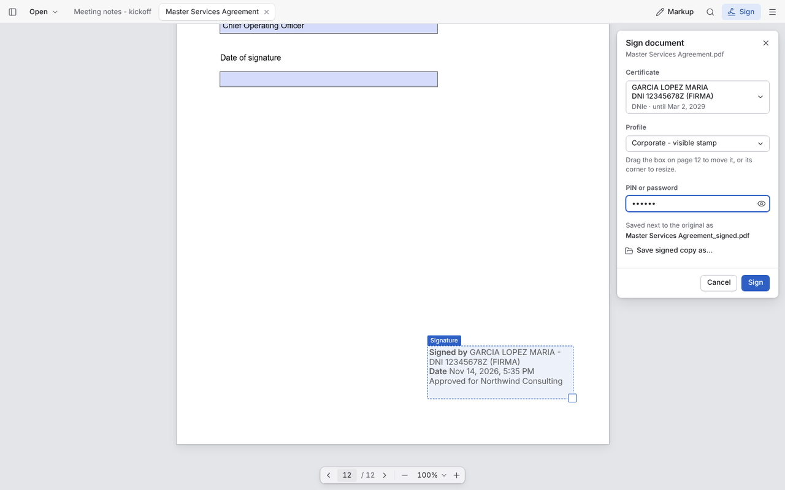
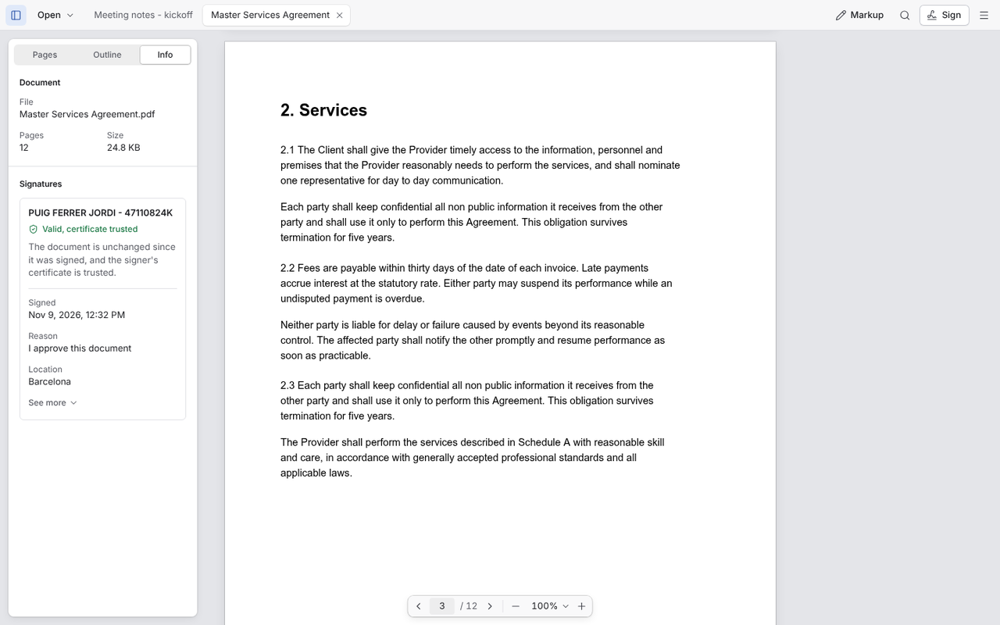
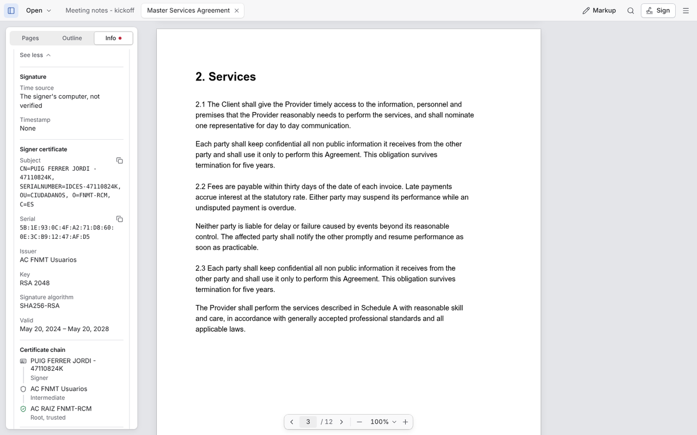

# Signing

Lankir signs PDFs with an X.509 certificate (PAdES, with an optional trusted
timestamp) and checks the signatures in the PDFs you open.

- [Certificates](#certificates)
- [Signature profiles](#signature-profiles)
- [Sign a document](#sign-a-document)
- [Check signatures](#check-signatures)
- [Online revocation checking](#online-revocation-checking)
- [Timestamps](#timestamps)
- [Privacy](#privacy)

## Certificates

Lankir looks for certificates in three places. **Settings › Certificates**
lists what it found (press **Refresh** to look again) and where it looks.

### Certificate files (PKCS#12)

`.p12` and `.pfx` files in the **certificate folders**. Lankir reads the files
directly in each folder, not in subfolders. By default the folders are the
system certificate folders (`/etc/ssl/certs`, `/etc/pki/tls/certs`,
`/etc/pki/ca-trust/extracted/pem`, `/usr/share/ca-certificates`) and, in your
home folder, `.pki/nssdb`, `.mozilla/firefox` and `.thunderbird`.

To use your own file, put it in a folder and add that folder with
**Add folder…**. **Restore default folders** puts the list back.

A password-protected file shows as **Password-protected file** until you sign
with it: Lankir reads it when you type its password in the sign panel.

Certificate files without a key (`.crt`, `.cer`, `.pem`) in the same folders
are listed too when their key usage allows signing, but they can't sign.

### Smart cards and tokens (PKCS#11)

Smart cards, USB tokens and the Spanish electronic ID card (DNIe) are reached
through a PKCS#11 library, listed under **Smart card and token libraries**. By
default Lankir tries the OpenSC and p11-kit libraries at their usual paths:

- `/usr/lib/x86_64-linux-gnu/opensc-pkcs11.so` and
  `/usr/lib/x86_64-linux-gnu/pkcs11/p11-kit-client.so` (Debian, Ubuntu)
- `/usr/lib64/opensc-pkcs11.so` and `/usr/lib64/pkcs11/p11-kit-client.so`
  (Fedora, openSUSE)

For a card or token whose maker ships its own library, add the library's `.so`
file with **Add library…**. **Restore default libraries** puts the list back.

For a DNIe, or any card read through OpenSC:

1. Install the card reader service and OpenSC, for example
   `sudo apt install pcscd opensc` (Debian, Ubuntu) or
   `sudo dnf install pcsc-lite opensc` (Fedora), and make sure the `pcscd`
   service is running (`sudo systemctl enable --now pcscd.socket`).
2. Insert the card in the reader, then open the sign panel or press
   **Refresh** in Settings.

The card's certificates show as **DNIe** or **Smart card** in the sign panel.
The PIN is asked when you sign.

### NSS database

Certificates with a private key in the shared NSS database at `~/.pki/nssdb`,
the one Chrome, Chromium and other programs use on Linux. These show as **NSS
database**. Firefox keeps its own database in its profile, which Lankir doesn't
read; export the certificate from Firefox to a `.p12` file instead.

### Which certificates can sign

The sign panel lists the certificates that can sign first. The others are
listed but can't be chosen, with the reason: no private key, expired, or not
valid yet. A certificate that expires within 30 days is marked.

The same lists are available from the command line: `lankir cert list`
([Command line](cli.md#lankir-cert-list)).

## Signature profiles

A profile says whether a signature is drawn on the page and what it shows.
Manage them in **Settings › Signing › Signature profiles**.

Lankir starts with two: **Invisible Signature** (the default) and **Visible
Signature** (name and date). **New profile** and the pencil on a profile open
the editor:

- **Name**, **Description**.
- **Type**: **Invisible** (recorded in the PDF only; readers list it in their
  signature panel) or **Visible** (also drawn in a box on a page).
- **Location**: free text recorded in the signature.
- **Default profile**: picked first when you sign.

For a visible profile:

- **Appearance**: the signer's name, the date and time (in your local time),
  the location, extra text, and an image (PNG, JPG or SVG, up to 2 MB) left of
  or above the text. A preview shows the result.
- **Position**: with **Set a default position** on, the box starts on the first
  or last page at the given X, Y, width and height, in points from the bottom
  left of the page. Off, the box starts in the middle of the page you are on.
  Either way you can move it when you sign.

Profiles are saved in `~/.config/lankir/signature_profiles/` (under
`$XDG_CONFIG_HOME` if you set it), one file per profile.

## Sign a document

1. Open the PDF and press **Sign** (Alt S). If the document has unsaved
   changes, Lankir asks to save them first: it signs the file on disk.
2. In the sign panel, pick the **Certificate** and the **Profile**. Lankir
   remembers the last ones you used.
3. For a visible profile, the signature box appears on the page. Drag it to
   move it, drag its corner to resize it, or drag on any page to draw a new box
   there.
4. Type the **PIN or password**: the card or token PIN, or the `.p12` file's
   password. For an NSS database certificate it is optional.
5. Press **Sign** (or Enter).

Lankir saves the signed copy next to the original as `<name>_signed.pdf`
(`<name>_signed_2.pdf` and so on if that exists) and opens it in a tab. The
original is not changed. To choose the name and folder, press **Save signed
copy as…** instead of **Sign**; the copy must be a different file from the
original.

A wrong PIN or password clears the field so you can try again. Esc or
**Cancel** closes the panel without signing.

An invisible signature on a document that has no signatures yet is a
certification signature: it allows filling in form fields and adding more
signatures afterwards. Other signatures are approval signatures.

## Check signatures

Open the side panel and choose **Info**. Each signature shows the signer, a
status line, a sentence explaining it, and when, why and where it was signed.
**See more** opens the details:

- **Signature**: where the signing time comes from (a trusted timestamp, or the
  signer's computer, which nobody verified) and the timestamp's status.
- **Signer certificate**: subject, serial number, issuer, key, signature
  algorithm and validity dates, with copy buttons.
- **Certificate chain**: from the signer up to the root, marked trusted or not
  trusted.
- **Checks**: whether the document is unchanged, whether the issuer is trusted,
  whether the certificate was revoked and how that was checked, and any
  warnings.

The status line is one of:

| Status | Meaning |
|--------|---------|
| Valid, certificate trusted | The document is unchanged since it was signed, the certificate chains to a root this system trusts, and it was checked and not revoked. |
| Valid, revocation not checked | Unchanged and trusted, but **Check revocation online** is off, so revocation wasn't checked. |
| Valid, revocation couldn't be checked | Unchanged and trusted, but Lankir got no usable answer about revocation (offline, server down, or the list is only on LDAP). |
| Valid, certificate revoked after signing | Unchanged, and a trusted timestamp shows the document was signed before the certificate was revoked. |
| Valid, certificate not trusted | Unchanged, but the certificate doesn't chain to a root this system trusts, so the signer's identity is not confirmed. |
| Certificate revoked | The certificate was revoked; the signature can't be trusted. |
| Invalid signature | The document was changed after signing, or the signature is damaged. |

If the signatures can't be read at all, Info says **Couldn't check
signatures** with the reason.

"Trusted" means the certificate chains to a root in the system's certificate
store (the `ca-certificates` bundle on most distributions). To trust another
root, add it to the system store, for example with `update-ca-certificates`.

The same check is available as `lankir sign verify` ([Command
line](cli.md#lankir-sign-verify)).

## Online revocation checking

**Settings › Signing › Check revocation online** (on by default) lets Lankir
ask the certificate authority whether a signer's certificate was revoked, when
it checks signatures.

- Lankir first uses any revocation data embedded in the PDF. It goes online
  only for what the PDF doesn't carry.
- It asks only for certificates whose chain the system trusts, and only the
  OCSP and CRL servers named in those certificates. Certificates from an
  untrusted issuer are not checked online, so a PDF can't make Lankir contact
  servers of its author's choosing.
- Each request times out after 10 seconds, and all of them for one document
  after 30 seconds. A downloaded revocation list is limited to 32 MB.
- Offline, or when the servers don't answer, the status is **Valid, revocation
  couldn't be checked**. Lankir asks again the next time it checks the
  document. A result it did get is reused for 10 minutes while the file is
  unchanged.
- With the setting off, Lankir contacts no server and the status is **Valid,
  revocation not checked**.
- Only HTTP and HTTPS revocation lists are downloaded. A certificate whose
  list is published only over LDAP (some FNMT certificates, for example) and
  that names no OCSP server can't be checked: **Not checked: the revocation
  list is only on LDAP**.
- An OCSP server that answers "unknown" doesn't know the certificate. Lankir
  doesn't read that as a revocation: with no other answer the status is
  **Valid, revocation couldn't be checked** (**The certificate authority
  doesn't know this certificate**).
- The sign panel asks the same way about the certificate you chose, OCSP first,
  then the revocation list. If it was revoked, the panel says since when and
  Sign is off; choose another certificate. If no server answered, a note says
  so and you can still sign. Lankir needs the certificate's issuer for this: a
  `.p12` that opens without a password, or the NSS database, has to hold it,
  unless the system trusts it directly. An answer is reused for 5 minutes.
- `lankir sign verify --offline` contacts no server, whatever the setting.

## Timestamps

**Settings › Signing › Timestamp server** adds a trusted time from an RFC 3161
timestamp server to each signature (PAdES B-T), for example
`http://timestamp.digicert.com`. Leave it empty to sign without one; the
signature then records only your computer's clock.

Signing contacts the timestamp server, so it needs a network connection while
the setting is filled in. `lankir sign pdf` uses the same setting unless you
pass `--tsa`.

## Privacy

- **Look up my location** (off by default): when a profile shows the location,
  Lankir sends your IP address to ipinfo.io at signing time and writes the
  city, region and country it returns into the signature. If the lookup fails,
  or the setting is off, the profile's own Location text is used. Off, nothing
  is sent.
- **Check revocation online**: contacts the OCSP and CRL servers named in
  trusted signers' certificates, and in the certificate you choose to sign
  with, as described above. The certificate
  authority can see which certificate was checked.
- **Timestamp server**: when set, sends a hash of the signature (not the
  document) to that server.
