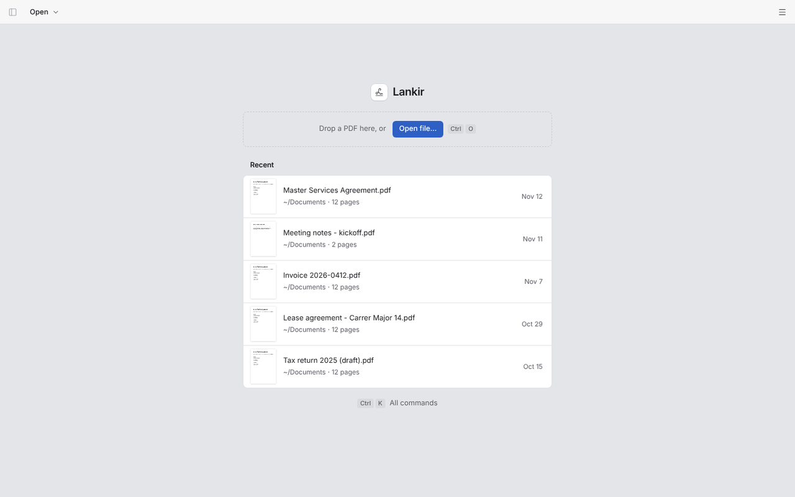
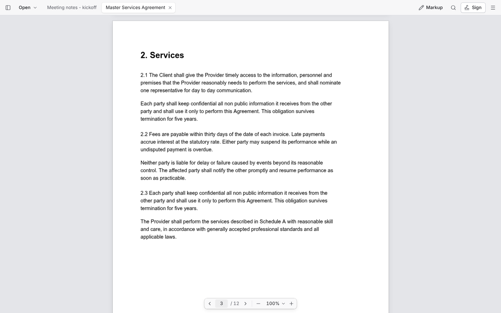
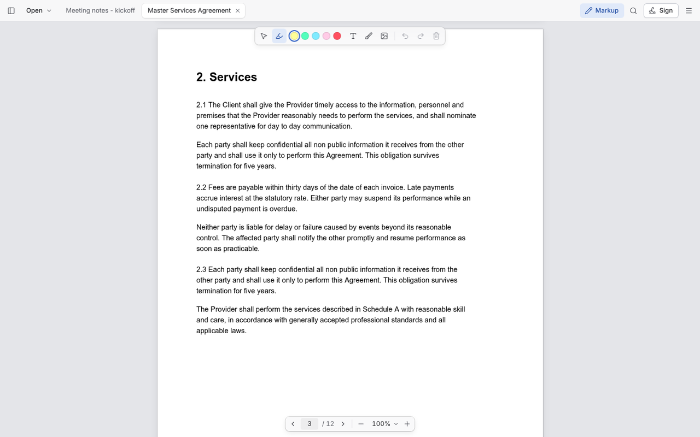

# User guide

How to open, read, fill in, mark up, organize and save PDFs in Lankir.
Signing and checking signatures have their own page: [Signing](signing.md).

- [Open a document](#open-a-document)
- [The window](#the-window)
- [Read](#read)
- [Fill in forms](#fill-in-forms)
- [Markup](#markup)
- [Organize pages](#organize-pages)
- [Document tools](#document-tools)
- [Save](#save)
- [Command palette](#command-palette)
- [Settings](#settings)
- [Keyboard shortcuts](#keyboard-shortcuts)

## Open a document

- **Open** in the header, **Open file…** on the start page, or Ctrl O, shows
  the file chooser.
- The arrow next to **Open** lists recent files and, when a document is open,
  **Start page**. The start page lists them too, with a thumbnail; the ✕ on a
  row removes it from the list (not from disk).
- Drop PDF files anywhere on the window. Other kinds of file are ignored.
- From the file manager, use **Open with › Lankir**, or make Lankir the default
  PDF app (see [Install](install.md#open-pdfs-with-lankir)).
- From a terminal: `lankir file1.pdf file2.pdf`.

Each document opens in its own tab. If Lankir is already running, documents
opened from the file manager or the terminal go to the running window.
**New window** in the menu (Ctrl Shift N) opens a second, separate window with
the current document.

A password-protected PDF asks for its password before it opens.

## The window

**Header**, left to right:

- **Side panel** button: shows or hides the side panel.
- **Open** and its recent-files menu.
- **Tabs**, one per document. A dot in place of a tab's ✕ means it has unsaved
  changes. When the tabs don't fit, the last ones move to a **N more** menu at
  the end of the strip; the active tab always stays visible. Ctrl Tab goes to
  the next tab.
- **Markup**: shows the markup tools.
- **Find** (magnifier): Ctrl F.
- **Sign**: opens the sign panel ([Signing](signing.md)).
- **Menu** (☰): **All commands**; under File, **Save**, **Save as…**,
  **Revert to saved…**, **Print…** and **Close tab**; under Document,
  **Organize pages** and the [document tools](#document-tools); then
  **New window**, **Settings** and **Keyboard shortcuts**.

**Side panel**, three views:

- **Pages**: page thumbnails; click one to go to that page. **Organize pages**
  at the top opens the [page grid](#organize-pages).
- **Outline**: the document's bookmarks, if it has any; click to go there,
  use the arrows to open or close a section.
- **Info**: file name, page count, size, and the document's signatures. A
  coloured dot on **Info** means a signature has a problem.

Drag the panel's edge to resize it; double-click the edge to go back to the
default width. With the edge focused, the arrow keys resize it (Shift for
bigger steps), Home and End go to the narrowest and widest. The width is
remembered.

**Page and zoom pill**, at the bottom of the document:

- Previous and next page, and the page number field: type a number and press
  Enter to go there.
- Zoom out, the zoom field (type a percentage from 10 to 2500), the zoom menu
  (**Fit width**, **Fit page**, 50% to 400%), zoom in.
- Ctrl and the mouse wheel zoom around the pointer.

## Read

**Find** (Ctrl F) searches the document's text. Enter goes to the next match,
Shift Enter to the previous one, Esc closes the box. Options under the field:

- **Match case**: only matches with the same capital letters.
- **Whole words**: only whole words.
- **Highlight all**: marks every match, not only the current one (on by
  default).

**Select and copy text** by dragging over it, then Ctrl C. This works with the
**Select** tool, which is the one in use while the markup tools are hidden.
Scanned pages without a text layer have no text to select or find.

**Links**: links inside the document go to their page. Web and email links open
in your default browser or mail app.

**Moving around**: Page Up and Page Down, Home (first page) and End (last
page). The left and right arrow keys turn pages when the page fits the window
sideways.

## Fill in forms

Click a form field and type, or tick boxes and pick options, with the
**Select** tool. Form fields are highlighted on the page. The values are
written into the file when you save.

## Markup

**Markup** in the header shows the tools above the page; click it again to hide
them, which also goes back to selecting text.

| Tool | Use |
|------|-----|
| Select | Select text and fill in forms. |
| Highlight | Drag over text to highlight it. Pick the colour (yellow, green, blue, pink, red) from the swatches next to it. |
| Text | Click on the page and type to add a text box. |
| Draw | Draw freehand with the pointer. |
| Image | Choose an image file (PNG, JPEG, SVG, WebP and others) to place on the page. |
| Undo, Redo | Ctrl Z and Ctrl Shift Z. |
| Delete selected | Removes the selected annotation (Delete key). |

Annotations are written into the PDF when you save, so other PDF readers show
them.

## Organize pages

**Organize pages** shows the document's pages in a grid, in place of the page
you are reading, to turn, move, copy, delete and extract pages and to add new
ones. Open it with:

- **Organize pages** at the top of the side panel's **Pages** view;
- **Organize pages** in the menu, under Document, or in the command palette;
- Ctrl Shift O, which also goes back to reading.

The markup tools, the find box and the sign panel close while you organize;
**Markup**, **Find**, **Sign** or the side panel button go back to reading.
Each tab keeps its own view: a tab you leave while organizing is still
organizing when you come back to it.

**Select pages**:

- Click a page to select it. Ctrl click adds or removes a page; Shift click
  selects every page from the last one clicked.
- Press on an empty spot and drag a box over pages to select them (with Ctrl
  or Shift held, they are added to the selection). A click on an empty spot
  clears the selection.
- Ctrl A selects every page. The arrow keys move between pages, Home and End
  go to the first and last; with Shift they extend the selection.
- Esc clears the selection; with nothing selected, it goes back to reading.

**Move pages** by dragging the selected pages: a line shows where they will
go, and the pill at the bottom says it ("Drop to move 2 pages after page 5").
Near the top or bottom edge the grid scrolls. Esc cancels the drag.

**The bar** above the grid works on the selected pages. It reads
**Organize pages** until pages are selected, then how many are; its ✕ clears
the selection.

| Button | Key | Use |
|--------|-----|-----|
| Rotate left, Rotate right | Shift R, R | Turn the pages a quarter turn. |
| Duplicate | Ctrl D | Copy the pages and put the copies after the last of them. |
| Extract… | | Write the pages to a new PDF (by default `name_pages.pdf`). The document doesn't change. From a protected document, the new file has the same password. |
| Delete | Delete | Remove the pages. Deleting more than one asks first; a document keeps at least one page. |
| Insert | | **Blank page after** the selection (or at the end, with nothing selected), sized like its neighbour, or pages **From file…** (see [Document tools](#document-tools)). |
| Undo, Redo | Ctrl Z, Ctrl Shift Z | Take back a page change, or bring it back. |
| Done | | Go back to reading. |

**Right-click a page** (or press Shift F10 or the Menu key) for its menu:
**Rotate left**, **Rotate right**, **Duplicate**, **Insert blank page after**,
**Insert pages from file…**, **Move to start**, **Move to end**,
**Extract…** and **Delete**. It works on the selection, or on the page you
clicked when it isn't selected.

**Read a page**: double-click it, or select it and press Enter, to open it in
the reading view.

**The pill** at the bottom changes the thumbnail size (**−**, the slider,
**+**, or Ctrl + and Ctrl −), and shows the page count and how many changes
are not saved.

**Signed documents**: in a signed document, pages with signature fields show
a badge. Changing the pages of a signed document breaks its signatures, so
before the first change Lankir asks **Change a signed document?**, names the
signers, and offers **Change anyway** or **Cancel**. To keep the signed file,
save the changed document with **Save as…** under another name. The same
question comes before changing a signed document's properties or password.

**Undo and save**: page changes don't touch the file until you save.

- Ctrl Z and Ctrl Shift Z, or **Undo** and **Redo** in the bar, take back page
  changes and bring them back, up to 20 changes. In the reading view, Ctrl Z
  and Ctrl Shift Z do the same when there is no markup edit to undo or redo.
- Undoing a page change also drops form and markup edits made after it; Lankir
  asks first.
- **Done**, with changes not saved, shows a toast such as **3 unsaved
  changes** with **Undo**, which takes them all back, and **Save** (Ctrl S).
- Saving writes the changes and starts a new undo history. **Revert to
  saved…** drops them instead.

Until you save, page changes are kept in `~/.cache/lankir/work` (under
`$XDG_CACHE_HOME` if you set it), readable only by you. Lankir removes them
when you save, close the tab or quit, and at the next start after a crash.
Unsaved page changes of a protected document may be kept there without its
password, which is why only that folder holds them.

## Document tools

The menu's Document section, and the command palette, hold tools for the
whole document; **Revert to saved…** and **Print…** sit under File. A tool
that doesn't apply is greyed out in the menu and missing from the palette:
**Split into files…** needs more than one page, **Remove password…** a
protected document, and **Revert to saved…** unsaved changes.

**Insert pages from file…** opens the file chooser; pick one or more PDFs (a
protected one asks for its password). The dialog lists them with their page
counts and asks **Where**: **At the start**, **After page N** (the page you
are on, or in Organize pages the last selected page) or **At the end**. The
new pages are a page change: undo them with Ctrl Z until you save.

**Split into files…** writes parts of the document to new files and leaves the
document as it is.

- **Page ranges**: one file per range, such as `1-3, 4, 6-12`.
- **Every N pages**: files of N pages each; the last one gets what is left.
- The preview shows each file, named `name_part1.pdf`, `name_part2.pdf` and so
  on, with its pages.
- **Choose folder…** picks where they go. Lankir doesn't replace files: if one
  of the names is already in the folder, it stops and says which.
- For a protected document, **Protect the new files with the same password**
  is ticked; untick it to write them without a password.

**Protect with password…** asks for a password twice (the eye shows what you
typed). On a protected document it reads **Change password…**.
**Remove password…** asks before it goes ahead. Either way, the change is
applied the next time you save; until then the tab counts as changed. A lost
password can't be recovered.

**Save optimized copy…** works like **Save as…**, but writes a smaller file
(redundant objects dropped, its structure compressed). Lankir goes on with
the new file, and the toast shows the size before and after.

**Properties…** shows the document's details (file, size, pages, PDF version,
producer, created and modified dates, whether it is protected or signed) and
lets you change its **Title**, **Author**, **Subject** and **Keywords**.
**Apply** makes that a change you can undo, written to the file when you
save.

**Revert to saved…** says which unsaved changes will be lost (page and
property changes, a password change, form and markup edits) and, on
**Revert**, reloads the file as it was last saved.

**Print…** (Ctrl P) prepares every page, form values and annotations
included, then opens the print dialog. A toast shows the page it has reached,
with **Cancel**. Pages print at the size of the first page; pages of another
size are fitted to it.

## Save

- **Save** (Ctrl S) writes your changes back to the file: form values,
  annotations, [page changes](#organize-pages), properties and a new or
  removed password. A protected document keeps its password unless you
  changed or removed it.
- **Save as…** (Ctrl Shift S) writes them to a new file and keeps working on
  that one. If the name you pick is open in another tab, Lankir offers to close
  that tab and replace the file.
- If the file changed on disk since you opened or saved it (another program
  wrote it), Lankir asks before overwriting: **Save as…**, **Cancel** or
  **Overwrite**.
- **Revert to saved…** in the menu drops every unsaved change and reloads the
  file (see [Document tools](#document-tools)).
- Closing a tab or the window with unsaved changes asks **Save changes before
  closing?** for each document: **Save**, **Don't save** or **Cancel**.
- Signing works on the file on disk, so Lankir asks to save unsaved changes
  before it signs.

## Command palette

Ctrl K (or **All commands** in the menu or on the start page) opens a list of
every command that applies now, grouped into File, Document, Go, View, Markup
and Application, each with its shortcut. Type to filter it; the letters only need
to appear in order, so `fw` finds **Fit width**. Arrow keys move, Enter runs,
Esc closes.

Some commands only show up when you type:

- recent files, by name;
- **Go to page N**, when you type a page number;
- zoom levels, such as **Zoom to 150%**.

The Application group also switches the theme: **Use light theme**, **Use dark
theme**, **Use the system theme**.

## Settings

Open **Settings** from the menu. Changes apply when you press **Save**.

| Section | What it holds |
|---------|---------------|
| Appearance | Theme (light, dark or the same as the system), accent colour, window tint. |
| Viewer | Default zoom for newly opened documents. Whether a new document opens with the side panel on Pages or on Info (signatures). |
| Files | How many recent files to list (up to 50). |
| Signing | Timestamp server, location lookup, online revocation checking, and signature profiles. See [Signing](signing.md). |
| Certificates | The certificates found, the folders searched for certificate files, and the smart card and token libraries. See [Signing](signing.md#certificates). |
| Shortcuts | Click a shortcut to record a new one. Keys Lankir handles itself can't be taken: Ctrl S, Ctrl Shift S, Ctrl W, Ctrl F, Esc (closing dialogs and menus) and the keys of [Organize pages](#in-organize-pages). |
| Advanced | Hardware acceleration (drawing with the graphics card; a change applies the next time Lankir starts), debug logging (more detail in the log, for bug reports), and the app's version. |

The settings are kept in `~/.config/lankir/config.json`; see
[Install](install.md#files-lankir-keeps). Shortcuts, the window tint and the
side panel width are kept by the app's web view in
`~/.local/share/com.lankir.Lankir`, not in that file.

## Keyboard shortcuts

Ctrl is the Control key. The first nine can be changed in
**Settings › Shortcuts**; these are their defaults.

| Shortcut | Action |
|----------|--------|
| Ctrl O | Open a file |
| Alt S | Sign the document |
| Ctrl + (or Ctrl =) | Zoom in (larger thumbnails in Organize pages) |
| Ctrl − | Zoom out (smaller thumbnails in Organize pages) |
| Ctrl Tab | Next tab |
| Ctrl Shift N | New window |
| Ctrl K | Command palette |
| Ctrl P | Print |
| Ctrl Shift O | Organize pages, and back to reading |
| Ctrl F | Find |
| Enter, Shift Enter | Next, previous match (in Find) |
| Ctrl S | Save |
| Ctrl Shift S | Save as |
| Ctrl W | Close the tab |
| Ctrl Z, Ctrl Shift Z | Undo, redo (markup, text fields and page changes) |
| Delete | Delete the selected annotation |
| Page Up, Page Down | Previous, next page |
| Home, End | First, last page |
| ←, → | Previous, next page (when the page fits sideways) |
| Ctrl + mouse wheel | Zoom around the pointer |
| Esc | Close the open menu, dialog, sign panel or find box |

### In Organize pages

| Shortcut | Action |
|----------|--------|
| R, Shift R | Rotate the selected pages right, left |
| Ctrl D | Duplicate the selected pages |
| Delete | Delete the selected pages |
| Ctrl A | Select every page |
| ←, →, ↑, ↓ | Move between pages; with Shift, extend the selection |
| Home, End | First, last page; with Shift, extend the selection |
| Enter | Open the selected page in the reading view |
| Shift F10, Menu key | The page menu |
| Ctrl Z, Ctrl Shift Z | Undo, redo page changes |
| Ctrl +, Ctrl − | Larger, smaller thumbnails |
| Esc | Cancel a drag; else clear the selection; else go back to reading |
