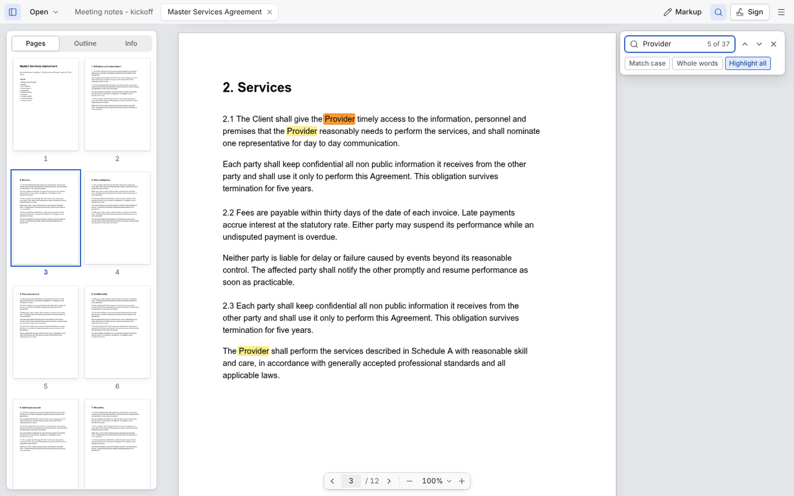
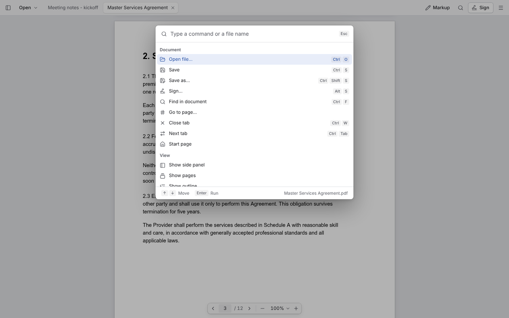

# User guide

How to open, read, fill in, mark up and save PDFs in Lankir. Signing and
checking signatures have their own page: [Signing](signing.md).

- [Open a document](#open-a-document)
- [The window](#the-window)
- [Read](#read)
- [Fill in forms](#fill-in-forms)
- [Markup](#markup)
- [Save](#save)
- [Command palette](#command-palette)
- [Settings](#settings)
- [Keyboard shortcuts](#keyboard-shortcuts)

## Open a document

- **Open** in the header, **Open file…** on the start page, or Ctrl O, shows
  the file chooser.
- The arrow next to **Open** lists recent files and, when a document is open,
  **Start page**. The start page lists them too, with a thumbnail; the ✕ on a
  row removes it from the list (not from disk).
- Drop PDF files anywhere on the window. Other kinds of file are ignored.
- From the file manager, use **Open with › Lankir**, or make Lankir the default
  PDF app (see [Install](install.md#open-pdfs-with-lankir)).
- From a terminal: `lankir file1.pdf file2.pdf`.

Each document opens in its own tab. If Lankir is already running, documents
opened from the file manager or the terminal go to the running window.
**New window** in the menu (Ctrl Shift N) opens a second, separate window with
the current document.

A password-protected PDF asks for its password before it opens.

## The window

**Header**, left to right:

- **Side panel** button: shows or hides the side panel.
- **Open** and its recent-files menu.
- **Tabs**, one per document. A dot in place of a tab's ✕ means it has unsaved
  changes. When the tabs don't fit, the last ones move to a **N more** menu at
  the end of the strip; the active tab always stays visible. Ctrl Tab goes to
  the next tab.
- **Markup**: shows the markup tools.
- **Find** (magnifier): Ctrl F.
- **Sign**: opens the sign panel ([Signing](signing.md)).
- **Menu** (☰): All commands, Save, Save as, Close tab, New window, Settings,
  Keyboard shortcuts.

**Side panel**, three views:

- **Pages**: page thumbnails; click one to go to that page.
- **Outline**: the document's bookmarks, if it has any; click to go there,
  use the arrows to open or close a section.
- **Info**: file name, page count, size, and the document's signatures. A
  coloured dot on **Info** means a signature has a problem.

Drag the panel's edge to resize it; double-click the edge to go back to the
default width. With the edge focused, the arrow keys resize it (Shift for
bigger steps), Home and End go to the narrowest and widest. The width is
remembered.

**Page and zoom pill**, at the bottom of the document:

- Previous and next page, and the page number field: type a number and press
  Enter to go there.
- Zoom out, the zoom field (type a percentage from 10 to 2500), the zoom menu
  (**Fit width**, **Fit page**, 50% to 400%), zoom in.
- Ctrl and the mouse wheel zoom around the pointer.

## Read

**Find** (Ctrl F) searches the document's text. Enter goes to the next match,
Shift Enter to the previous one, Esc closes the box. Options under the field:

- **Match case**: only matches with the same capital letters.
- **Whole words**: only whole words.
- **Highlight all**: marks every match, not only the current one (on by
  default).

**Select and copy text** by dragging over it, then Ctrl C. This works with the
**Select** tool, which is the one in use while the markup tools are hidden.
Scanned pages without a text layer have no text to select or find.

**Links**: links inside the document go to their page. Web and email links open
in your default browser or mail app.

**Moving around**: Page Up and Page Down, Home (first page) and End (last
page). The left and right arrow keys turn pages when the page fits the window
sideways.

## Fill in forms

Click a form field and type, or tick boxes and pick options, with the
**Select** tool. Form fields are highlighted on the page. The values are
written into the file when you save.

## Markup

**Markup** in the header shows the tools above the page; click it again to hide
them, which also goes back to selecting text.

| Tool | Use |
|------|-----|
| Select | Select text and fill in forms. |
| Highlight | Drag over text to highlight it. Pick the colour (yellow, green, blue, pink, red) from the swatches next to it. |
| Text | Click on the page and type to add a text box. |
| Draw | Draw freehand with the pointer. |
| Image | Choose an image file (PNG, JPEG, SVG, WebP and others) to place on the page. |
| Undo, Redo | Ctrl Z and Ctrl Shift Z. |
| Delete selected | Removes the selected annotation (Delete key). |

Annotations are written into the PDF when you save, so other PDF readers show
them.

## Save

- **Save** (Ctrl S) writes your changes (form values and annotations) back to
  the file.
- **Save as…** (Ctrl Shift S) writes them to a new file and keeps working on
  that one. If the name you pick is open in another tab, Lankir offers to close
  that tab and replace the file.
- If the file changed on disk since you opened or saved it (another program
  wrote it), Lankir asks before overwriting: **Save as…**, **Cancel** or
  **Overwrite**.
- Closing a tab or the window with unsaved changes asks **Save**, **Don't
  save** or **Cancel** for each document.
- Signing works on the file on disk, so Lankir asks to save unsaved changes
  before it signs.

## Command palette

Ctrl K (or **All commands** in the menu or on the start page) opens a list of
every command that applies now, grouped into Document, View, Markup and
Application, each with its shortcut. Type to filter it; the letters only need
to appear in order, so `fw` finds **Fit width**. Arrow keys move, Enter runs,
Esc closes.

Some commands only show up when you type:

- recent files, by name;
- **Go to page N**, when you type a page number;
- zoom levels, such as **Zoom to 150%**.

The Application group also switches the theme: **Use light theme**, **Use dark
theme**, **Use the system theme**.

## Settings

Open **Settings** from the menu. Changes apply when you press **Save**.

| Section | What it holds |
|---------|---------------|
| Appearance | Theme (light, dark or the same as the system), accent colour, window tint. |
| Viewer | Default zoom for newly opened documents. Whether a new document opens with the side panel on Pages or on Info (signatures). |
| Files | How many recent files to list (up to 50). |
| Signing | Timestamp server, location lookup, online revocation checking, and signature profiles. See [Signing](signing.md). |
| Certificates | The certificates found, the folders searched for certificate files, and the smart card and token libraries. See [Signing](signing.md#certificates). |
| Shortcuts | Click a shortcut to record a new one. Esc is kept for closing dialogs and menus. |
| Advanced | Hardware acceleration (drawing with the graphics card; a change applies the next time Lankir starts), debug logging (more detail in the log, for bug reports), and the app's version. |

The settings are kept in `~/.config/lankir/config.json`; see
[Install](install.md#files-lankir-keeps). Shortcuts, the window tint and the
side panel width are kept by the app's web view in
`~/.local/share/com.lankir.Lankir`, not in that file.

## Keyboard shortcuts

Ctrl is the Control key. The first seven can be changed in
**Settings › Shortcuts**; these are their defaults.

| Shortcut | Action |
|----------|--------|
| Ctrl O | Open a file |
| Alt S | Sign the document |
| Ctrl + (or Ctrl =) | Zoom in |
| Ctrl − | Zoom out |
| Ctrl Tab | Next tab |
| Ctrl Shift N | New window |
| Ctrl K | Command palette |
| Ctrl F | Find |
| Enter, Shift Enter | Next, previous match (in Find) |
| Ctrl S | Save |
| Ctrl Shift S | Save as |
| Ctrl W | Close the tab |
| Ctrl Z, Ctrl Shift Z | Undo, redo (markup and text fields) |
| Delete | Delete the selected annotation |
| Page Up, Page Down | Previous, next page |
| Home, End | First, last page |
| ←, → | Previous, next page (when the page fits sideways) |
| Ctrl + mouse wheel | Zoom around the pointer |
| Esc | Close the open menu, dialog, sign panel or find box |
